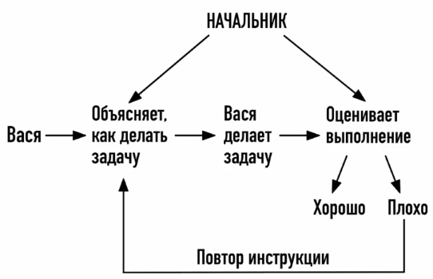
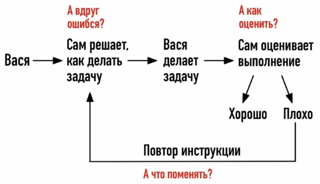
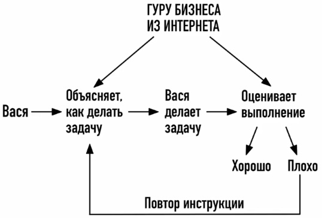
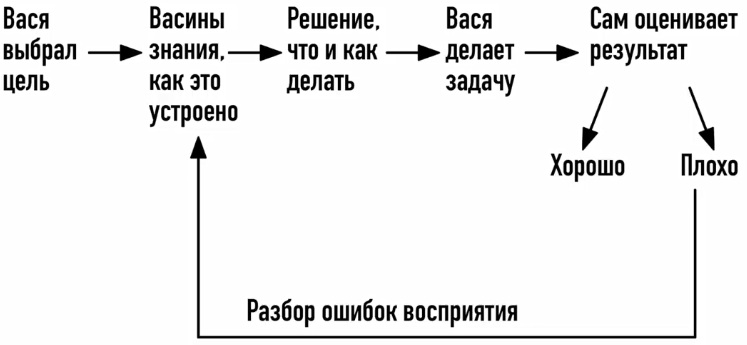
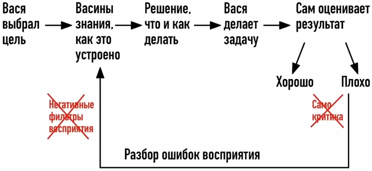

# Как перестать ошибаться и опускать руки. Убираем слепые зоны в мышлении за 4 шага

https://www.youtube.com/watch?v=dIHVa__dwLk

Просто начать что-то делать — этого мало. Нужно ещё уметь выбирать действия, которые ведут к результату. Потому что есть очень много людей, которые активны, позитивны, они верят в себя и в свой успех, но при этом всю жизнь их преследуют неудачи. Со стороны всегда кажется, что человек предприимчивый, у него всегда какие-то движения, хотя на самом деле там нет ни результатов, ни клиентов, ни денег. И он постоянно в долгах, выкручивается, перепрыгивает с одной темы на другую. И у каждого человека есть риск повторить такую судьбу, если не устранять слепые зоны в мышлении.

Критерий очень простой. Если вы пытаетесь, но у вас не получается то, что вы задумали, или если у вас опускаются руки после первой попытки, или вы вообще ничего не делаете — значит, у вас точно есть эта слепая зона.

Я понимаю, что эта тема не даст много просмотров, но всё равно записываю, потому что мне когда-то самому не хватило именно таких объяснений, чтобы прям разжевали. О том, как добиваться результата, мне рассказали ещё в 21 год. Это вот правда простой принцип, он работает так, что ты что-то задумал, попробовал, у тебя получилось. И я тогда просто вот не понял, не дошло до меня, и мне целых 10 лет потребовалось, чтобы хоть как-то понять. А вы это поймёте уже сегодня, если досмотрите ролик до конца.

Сразу предупреждаю, что объяснять буду очень просто, вот как будто для детей, потому что эта слепая зона будет срабатывать прямо во время просмотра. И у неё всегда одно и то же последствие. Вот вам кажется, что всё просто, очевидно, вы всё поняли, хотя на самом деле не поняли. Вам кажется, что вы всё знаете, но вы не знаете.

## Откуда берётся слепая зона в мышлении

Для начала давайте разберёмся, откуда берётся вот эта слепая зона в мышлении. Как обычно, всё идёт из детства, всё начинается со школы. Тебе показывали, как решать задачку, ты повторял. Если плохо получилось — тебя поругали. Хорошо получилось — тебе поставили высокую оценку. Не получилось — давай тренируйся ещё, повторяйся, пока не получится. Если вы внимательно присмотритесь к окружающему миру, то обнаружите, что именно по этой схеме мы продолжаем жить, и именно эта схема организует наше мышление. И дальше покажу, где она даёт сбой.

Вот представьте, что есть Вася. У него есть начальник. Начальник ставит задачу и объясняет, как её делать. Вася действует, а начальник оценивает: правильно или неправильно. Если правильно, то Васю хвалят, он чувствует облегчение. А если неправильно, то Васе стыдно и начальник ему тогда подсказывает, что нужно исправить. Вася пробует ещё раз и вот делает это, пока не получится. По этой схеме Вася может прожить всю жизнь, если будет работать по найму и с чёткими инструкциями.

Но однажды Вася решает открыть своё дело. Начальник исчезает, и тут же возникают первые трудности. Теперь Васе нужно самому понимать, а что делать? А вдруг он поймёт неправильно. Ему нужно самому оценивать каждый шаг. А если не получилось, то надо понять, что сделано не так, и что-то исправить. А вдруг он неправильно определит? 

Но у Васи нет другого принципа мышления, поэтому обычно происходит так: он просто по привычке идёт искать, вот кто же ему объяснит, как правильно действовать. Он доверяется первому, кто ему даст больше гарантий, пробует уже по его инструкции — не получается. Тогда он думает, что надо ещё постараться, снова не получается. И тогда он думает: надо найти другую инструкцию. Опять идёт, ищет, ему опять что-то рассказывают, опять получается не рабочая инструкция — и вот так до бесконечности.

И это только выглядит, как будто поиск решения. Хотя на самом деле это просто повторение того самого паттерна: найди готовый ответ и выполняй в точности. А нужен другой принцип мышления и действий. Вот не такой, как в школе был и как в наёмной работе.

## Привычка нападать на себя

Прежде чем перейти к этому главному принципу, надо ещё устранить одну привычку, которая будет мешать. Это тоже вы берёте из школы и из детства. Дело в том, что после неудачи в самостоятельных действиях вы обычно смещаете фокус на себя. То есть: это у меня не получилось, я плохо делал, я какой-то бестолковый, недостаточно постарался. И дальше вот вы утопаете в самокритике и сомнениях.

Раньше были очень популярны такие публичные бизнес-тренинги. И там спикеры этим пользовались. То есть они давали людям нелепые задания, которые к теме вообще не имели отношения. Человек всё это выполнял старательно. Естественно, у него ничего не получалось. И он винил в первую очередь себя, что это он плохо сделал. А потом на сцену выводили подставного участника, у которого якобы всё получилось по этой инструкции. И участники ещё больше укреплялись в мысли, что, блин, я дурак, я ничего не понял, надо ещё больше стараться, ещё попробовать.

Вот эта привычка нападать на себя или даже нападать на других не даёт задуматься о самом главном вопросе. И мы как раз к нему подбираемся.

## Главная истина: правильное действие даёт результат

Сейчас внимание. Нужно осознать одну простую истину. Неважно, какой вы человек, как сильно вы старались, идеально всё сделано или нет. **Если действие изначально было правильным, то результат будет**. Вот неважно, какое было исполнение — даже очень плохое, кривое, косое.

Я раньше работал маркетологом и видел изнутри, что происходит в разных бизнесах, включая всякие стартапы. Я искренне удивлялся: вот сайт кривой, продукт слабый, сервис никакой, менеджеры тупят, руководство всякую фигню предлагает. И вот как это вообще запустилось и почему это до сих пор выживает? Люди просто определили и сделали правильные действия. И они сделали, как смогли. Проект может быть из говна и палок, но он всё равно работает. Потому что если действие правильное, результат будет. Это вот просто закон природы.

## Что такое правильное действие

Теперь переходим к главному вопросу. А что такое правильное действие? Это то действие, которое привело к ожидаемому результату. А как выбрать правильное действие? А это возможно только при одном условии: если вы адекватно воспринимаете реальность. И вот именно на понимании вот этой фразы у меня ушло 10 лет.

Адекватность означает, что ваше восприятие работает без ошибок. То есть вы видите себя, других людей и ситуации именно такими, какие они есть. Теперь нужно это расшифровать. Я это сделаю при помощи двух примеров. Один такой совсем простой, бытовой, чтобы понял любой человек, независимо от опыта. А второй будет на более сложной задаче, которая есть у любого предпринимателя. А в конце дам общую схему этого нового принципа мышления — уже без слепых зон.

### Пример 1. Бытовой: перекрасить стены в офисе

Первый пример — это история из моей жизни, где-то 8 лет назад это было. Мне нужно было перекрасить стены в офисе. Я нашёл человека на «Авито», объяснил задачу, отдал ему предоплату и ушёл. На следующий день прихожу и вижу, что там стены не прокрашены, просвечивается старая краска, плинтуса все заляпаны. Я естественно раздражаюсь, но себя в руках как-то сдерживаю, указываю на недостатки и прошу переделать. Мне человек, конечно, объясняет, что он всё сделает, выпрашивает ещё часть предоплаты, я ему отдаю, ухожу. На следующий день прихожу — он вообще всё покидал и ушёл, то есть пропал.

Во-первых, нет смысла обвинять себя, либо этого мастера. Факт только в том, что ожидания не совпали с реальностью. А это произошло именно из-за моих действий. А действия были такие, что я не проверил человека, взял вот первого, который согласился выполнить завтра. Я не узнавал среднюю стоимость по рынку, не смотрел отзывы, не прописывал договор, не объяснял ему вот критерии, как я буду принимать решение.

А почему я действовал неправильно? Потому что у меня были неправильные представления о реальности. Мне казалось, что задача настолько лёгкая, что справится вообще любой человек. А если это легко, значит мастеров полно, можно хоть на следующий день найти. А если их полно, значит это дёшево. А если всё это вместе собрать, то можно брать любого первого попавшегося. То есть я отказался воспринимать реальность, и поэтому результат был не тот, который ожидал.

Вот как правильно учитывать реальность — конкретный алгоритм мы уже рассмотрим на следующем примере.

### Пример 2. Предпринимательский: как получить клиентов из соцсетей

У любого предпринимателя есть одна и та же задача: надо что-то кому-то продавать. И вот мне часто пишут коллеги-психологи, чтобы поинтересоваться, спросить совет: а что делать, чтобы получить клиентов из социальных сетей? Так как я в этой теме как-то разобрался, то я хорошо вижу, где у кого слепая зона.

Человек пишет: «Я всё делаю, как советуют, снимаю ролики каждый день, но никто не подписывается, клиентов как не было, так и нет». То есть есть ожидания, есть действия, но результатов нет. Этот пример очень хороший для разбора, потому что когда нам нужно повлиять на поведение другого человека, убедить отдать деньги — вот здесь нужен очень хороший контакт с реальностью. Если его не будет, то ничего не получится.

## Новая схема мышления без слепых зон

Давайте рассмотрим новую схему мышления, которая уже исключает слепые зоны. У нас опять есть Вася, и он уже сам определяет для себя цель. Потом у него есть какие-то представления о том, как всё устроено. И исходя из этого он определяет, как нужно действовать. Потом он это выполняет и оценивает результат. Если соответствует ожиданиям — то всё классно, Вася идёт дальше. А если не соответствует, то происходит разбор полётов. То есть нужно подумать, а что пошло не так, где была ошибка его восприятия, что не было учтено. То есть опять мы переходим к тому, что нужно корректировать представление о том, как это устроено. И дальше цикл повторяется, пока не будет результата, соответствующего ожиданиям.

А сложность здесь именно в деталях. Во-первых, как определять первый шаг? А какие ожидания нужно формировать? А если ожидания не совпали — надо как-то корректировать. А на что обращать внимание? Вот какой параметр нужно поменять? Всё это неясно.

### Как корректировать представления о реальности

Для начала поговорим, опять, вот как обычно бывает. Действие всегда строится на текущих знаниях. То есть в начале они какие-то поверхностные, где-то что-то слышал. Ну вот допустим, человек думает, что я опубликую ролик, он попадёт в рекомендации, людям понравится, они подпишутся, я наберу тысячу подписчиков, ко мне будет больше доверия, и вот тогда люди будут записываться на консультации. И поэтому человек выбирает такие действия: найду ролик, который уже залетел, перепишу сценарий, буду снимать и публиковать каждый день, ну я думаю, что придёт примерно 100 человек. Делает — допустим, ничего не залетело, пришло 0 подписчиков. Ожидания не оправдались, значит, нужно менять представление о действительности, как-то их корректировать.

**Контакт с реальностью мы всегда восстанавливаем через вопросы**. Чем их будет больше, тем лучше. У новичка обычно такие вопросы: а какие темы сейчас популярны? Как надо выглядеть? Какая должна быть подача? В какое время лучше публиковать ролики, чтобы залетали? И дальше человек, исходя из ответов на эти вопросы самому себе, решает, как поменять действия. Допустим, наш человек думает, что вот залетают ролики, где люди какие-то такие классные, эмоциональные, у них подача хорошая. И он думает: значит, мне нужно вот это поменять. И вот он пробует по-новому, выкладывает — результатов нет. Он думает: ну надо ещё изменить как-то подачу, ещё раз пробует — опять результатов нет.

И возникает вопрос: а сколько раз пробовать? Когда остановиться? Как понять, мы вообще тот параметр меняем или нет? Вот это уже сложнее. На самом деле, чем больше неудач и чем быстрее они случаются, тем лучше. Каждая попытка должна заставлять усомниться в своих собственных представлениях и вообще — правильные ли вопросы задаются. То есть эта мотивация узнать больше, копать глубже. Человек из нашего примера по идее должен несколько раз проэкспериментировать с формой подачей и понять, что дело вообще не в этом. То есть он вопросы задаёт по поводу фасада, картинки, как это лучше выглядит.

Восприятие станет более адекватным только тогда, когда человек дойдёт до вопросов о самой механике. То есть: а как ролик вообще попадает в рекомендации? А почему люди досматривают до конца? А почему они подписываются? А почему они должны обратиться именно ко мне? Что их заставит? И вот эти вопросы — они про поведение людей, как они формируют доверие, как они принимают решение.

### Самый короткий путь к правильным вопросам

Есть самый короткий путь и к правильным вопросам, и к правильным ответам. С одной стороны, естественно, нужно изучать теорию. Но самое главное — нужно наблюдать за тем, а что реально работает у других, кто занят в этой же теме. То есть не слушать их обещания и рассказы, потому что они часто врут, приукрашивают, а именно смотреть на действия и пытаться вычленить какой-то принцип. И когда вы докопаетесь до сути, не нужно копировать действия другого — нужно обязательно адаптировать всё под себя.

## Помеха: привычка оценивать чужие действия

Но есть ещё одна помеха, которая помешает вам идти по этому короткому пути. Это тоже привычка, которую вы взяли из детства: вы смотрите на чужие действия и постоянно оцениваете. То есть вы думаете: это фигня, это мне не подходит, а это не красиво, это вообще ниже моего достоинства, а это я не смогу. А ещё может быть такое, что вам прямо больно смотреть на чужие действия, потому что вы видите чужой успех и как будто не выдерживаете его. Можно сказать, что у вас как-то корёжит внутри — то ли от зависти, то ли от того, что это бьёт по самооценке. И поэтому вы как будто бы ищете особый путь: вот надо сделать не так, как у других. И это всё вместо того, чтобы просто взять то, что реально работает, и как-то применить для себя.

Именно за этой привычкой, за этой негативной оценкой, прячется вся нужная информация. Вот та самая причина, почему у других всё получается, а у вас нет. Отсюда следует очень важная мысль: **реальность нужно воспринимать без оценок, непредвзято, то есть непосредственно**.

## Инстинкт самосохранения и искажения восприятия

Дело в том, что ваша психика бессознательно, помимо вашей воли, оценивает вообще каждую задачу. У неё цель — определить угрозу. Можно сказать, что так работает инстинкт самосохранения. Оценка, что страшно, что нет, происходит на основе прошлого опыта. Проблема в том, что эта оценка часто происходит с ошибками. Если у вас был травматичный опыт, то психика будет видеть угрозы в любых похожих ситуациях.

Допустим, в детстве на уроке вы неправильно ответили, над вами посмеялся весь класс. Это травма. Сейчас вы уже взрослый человек и решили опубликовать ролик в интернете. Но психика это воспринимает как угрозу повторения той ситуации и поэтому она будет блокировать это действие. Если вы адекватно воспринимаете реальность и нашли правильные действия, но психика почему-то видит там мнимую угрозу, то вы не сможете заставить себя действовать — возникнет внутреннее сопротивление.

Это значит, что нужно ещё исправлять искажения своего восприятия, вот именно те, которые уже мешают действовать.

## Заключение и итоговая схема

О том, как это делать, о конкретных инструментах, есть отдельная лекция. Она называется «Формула продуктивности». Там я рассказываю, при каких пяти психологических условиях у человека возникает естественное желание действовать. То есть это внутренняя мотивация: не нужно себя заставлять, буквально самостоятельно хочется приступить. Вводная часть этой лекции доступна по символической цене — всего лишь 490 рублей. А ещё к ней в подарок идёт моя книга. Называется «Современная профориентация: как искать дело жизни». Подробности о том, как получить материалы, будут в отдельном телеграм-боте. Ссылка на него в описании.

В конце, как и обещал, собираем всё в одну схему. Сделайте скриншот, сохраните себе и попробуйте разобрать задачу, которую вы уже выполняли и она не получилась.

1. **Шаг 1.** Нужно описать, что конкретно вы делали, шаг за шагом.
2. **Шаг 2.** Потом нужно определить, из какого представления вы исходили.
3. **Шаг 3.** Потом нужно найти слепые зоны — вот понять, что вы приняли на веру, какие вопросы не задали. И отсекайте всё, что связано с внешним, то есть с фасадом, вот с этой подачей. Нужно углубляться именно в суть: а как всё устроено, как работает на самом деле.
4. **Шаг 4.** И только потом составляйте новый план: а что ещё можно попробовать, исходя уже из более полной реальности.

Если захотите разобрать свой конкретный пример — описывайте задачу, что вы уже пробовали, из каких представлений исходили, и я буду накидывать, а что ещё можно вот прояснить для себя. Может быть, другие зрители тоже подключатся, и вы найдёте полезную информацию.

Меня зовут Максим Васильченко, я психолог. Последние три года специализируюсь только на терапии прокрастинации. Если вам интересна эта тема, тогда ставьте лайк и подписывайтесь на канал.