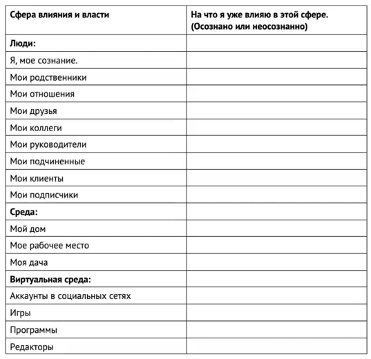
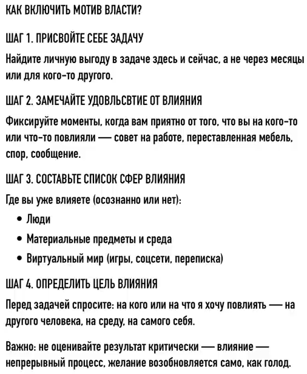

# Инстинкт власти и лень

https://www.youtube.com/watch?v=HovZG5PniOQ

## Почему к еде и сексу тянет, а к делам — нет

Желание секса и еды у нас почему-то достаточно сильное. То есть нам не нужно себя заставлять, мы легко идём готовить обед или поухаживать за девушкой. А вот когда нужно идти поработать, сделать свои дела или получиться — вот тут нам приходится каждый раз с собой бороться. И мы постоянно страдаем от лени и прокрастинации. А что если я скажу, что вы можете хотеть делать свои дела с таким же сильным и таким же устойчивым желанием? То есть не через «надо», не через силу воли, а у вас будет собственная тяга, вот такая же, как к вкусной булочке или привлекательной девушке.

Вам может показаться, что это разные вещи, потому что секс и еда — это физиологические потребности, и они приносят удовольствие. А вот в учебе и работе этого нет. Но дело в том, что желание работать, достигать своих целей тоже завязано на психологические потребности и на удовольствие от их закрытия. Просто вы не знаете, что это за потребность. А всё потому, что она у вас под глубоким запретом. И это следствие вашего воспитания. Что интересно, вы не замечаете и сам запрет, и дефицит от этой потребности.

## Механизмы подмены потребностей

Потому что в психике есть определённые механизмы для подмены. Например, потребность во внутреннем спокойствии мы можем заедать. Потребность чувствовать себя уверенно мы можем закрывать через алкоголь. Или потребность собственной ценности мы можем закрывать через покупки, через шопоголизм. С важными делами вот точно такая же история. Вы же когда-то пытались замотивировать себя деньгами, покупками, путешествиями, какими-то перспективами, но почему-то это не получается. Всё равно лень всегда побеждает. Потому что все эти заменители просто не работают. Всегда будет ощущаться внутренний дефицит, то есть что-то как будто не хватает. Поэтому — бесконечные попытки это закрыть.

И вот все абсолютно люди приходят к одному выводу: материальное само по себе не может мотивировать. Чтобы возникло влечение, прям такое сильное желание действовать, нужно связать свою задачу с базовыми инстинктивными потребностями. Когда человек действует и удовлетворяет такие мотивы, то он чувствует кайф, удовольствие. Если он попробует это хотя бы несколько раз, то он подсядет на это точно так же, как на секс и на еду.

## Мотив власти и влияние: исследование Макклелланда

Один из таких базовых инстинктивных мотивов — это потребность во власти и влиянии. И то, что это правда, есть абсолютно в каждом человеке, это доказал Дэвид Макклелланд. Исследование на эту тему есть в отдельной книге, она называется «Мотивация личности», издана на русском языке, каждый при желании может ознакомиться.

Что такое мотив власти? Это потребность оказывать влияние на кого-то и на что-то. И она развивается с самого младенчества. То есть она вырастает из врождённых реакций на естественные стимулы. Когда вы были совсем маленьким, вы получали удовольствие от того, что вызываете эмоции у взрослых. А ещё вы могли управлять их поведением через капризы и плач. А ещё было удовольствие от того, что вы воздействуете на предметы: вы их толкали, двигали, дёргали. И за счёт того, что долгое время вы постоянно получали позитивное подкрепление, так постепенно возникла устойчивая потребность во власти и влиянии.

## Власть пронизывает все взаимодействия — но мы этого не замечаем

Если задуматься, то становится понятно, что вообще все взаимодействия между людьми — они про влияние. Вот вы сказали своё мнение и повлияли на чужие взгляды. Оделись стильно и повлияли на впечатление о себе. То есть вы постоянно воздействуете на всех. Но обратите внимание, что вы про это не думаете. Вы больше сосредоточены на том, а как бы на вас что-то плохо не повлияло. То есть вы в тревоге и страхе, вот как бы чего с вами не случилось. Вот именно так проявляется внутренний запрет, который вам посадили из детства.

## Откуда берётся запрет на власть: воспитание и социализация

Потому что когда вы немножко подросли, вас уже начали наказывать вот именно за властное и агрессивное поведение. Потому что в принципе сам процесс воспитания — это вообще-то подчинение человека, сначала нормам семьи, а потом и всего общества. Обычно уже с трёх лет ребёнок находится в постоянном конфликте. Он хочет, чтобы было по его, а родители заставляют как надо. Естественно, что он не может победить в этом противостоянии. С одной стороны, социализация это полезно, потому что нас обучают, как встраиваться в общество. Но с другой стороны, в процессе взросления вот этого нам насаживают очень много лишних запретов, которые нас будут просто ограничивать.

### Примеры появления лишних запретов

Допустим, у ребёнка возник естественный импульс повлиять на среду. Ему захотелось что-то поменять, он взял гуашь и разрисовал стену в комнате. Потом пришли родители, они его наругали, побили и провели такую жёсткую беседу. И он усваивает запрет: «Я на чужой территории, мне тут ничего менять нельзя». И вот из-за этого у него даже привычка не сформируется думать о том, что и как поменять, чтобы под себя подстроить. Он уже будет взрослым человеком и всё равно ничего не будет предпринимать.

Второй пример. Мальчик поспорил с братом, он громко отстаивает свою точку зрения, вот ссорятся. Заходит в комнату папа и обоих наказывает за то, что они ему мешают отдыхать. Вот несколько раз повторилась такая ситуация, и у детей уже внутренний запрет на то, чтобы выяснять отношения, то есть влиять друг на друга. После такого жёсткого воспитания потребность во власти либо под полным запретом, либо сохраняется в урезанном виде. Естественно, что вы даже не можете задуматься, что желание влиять оно может как-то быть связано с вашими целями. А ведь это бесконечный источник мотивации.

## Шаг 1. Присвоить себе задачу

Теперь переходим к самому главному, поговорим о том, как восстановить вот эту связь между своими целями и мотивом влияния. Это всё для того, чтобы вы захотели делать так же сильно, как вы хотите есть или заниматься сексом. Секс и еда — это физиологические потребности. Они более понятные, потому что закрывают конкретную чувственную потребность: я получаю конкретное удовольствие, у меня есть понятные стимулы, и я знаю, что нужно конкретно делать. А вот наши действия ради своих целей, учёбы, работы, заработка, они устроены чуть сложнее. И в большинстве случаев самое первое препятствие — это некоторый разрыв, что как будто бы это нужно не мне, а это нужно кому-то другому. То есть чаще всего вы делаете что-то на внешней мотивации: это какой-то дядя сказал вам сделать вот это, если не сделать, он вас накажет, и вы за это получаете не удовольствие, а зарплату в конце месяца.

Отсюда следует первый шаг: надо присвоить себе задачу. Присвоить — это значит понять, а к какой личной выгоде это меня ведёт. То есть почему это нужно именно мне? Важно, чтобы вы уловили вот эту разницу. Как обычно бывает: допустим, студенту надо написать диплом, но это надо не ему, а преподавателю, и срок где-то через полгода. На работе нужно обзвонить клиентов, но это надо начальнику, и то там до конца недели. Фрилансеру надо сесть за проект, но это что надо клиенту, а не ему. И то по договору там целых два месяца ещё в запасе.

### Личный пример: как присвоить диплом

Приведу личный пример, как я сам когда-то присваивал задачу. Я также был студентом, мне надо было писать диплом. Я подумал, что для того, чтобы мне было это интересно, надо выбрать такую тему, которая будет готовить меня сразу к работе, и я тогда хотел заниматься тренингами. И мне научный руководитель подсказала, что можно взять тему тренинга развития эмоционального интеллекта у студентов-медиков. Каждый подход к диплому уже имел для меня личный смысл. Я готовился к тренингу и одновременно к работе. И поэтому у меня была очень высокая мотивация, и я постоянно регулярно этим занимался.

### Личный пример: как присвоить обзвон клиентов

Другой пример. Допустим, на работе нужно обзвонить клиентов. И надо тоже искать личный смысл. Вот чего я хочу? Самая простое — это если от этого зависит заработок. Но часто бывает такое, что на доход никак не влияет. И тогда всё равно нужно искать личную выгоду. И можно её найти в самой ситуации. Вот допустим, я понимаю, что вообще-то я испытываю тревогу при каждом звонке. Я тогда думаю: а я буду тренироваться от этого избавляться. Я изучил разные приёмы и теперь каждый звонок — это для меня поведенческий эксперимент. У меня появляется личный мотив, и мне проще к этому приступать.

## Шаг 2. Развивать стратегическое мышление

Чтобы было проще присваивать задачи и искать там личную выгоду, надо развивать стратегическое мышление. То есть думать на перспективу. Вот тоже пример, как у меня это было. После университета я, естественно, хотел стать психологом. Но я не знал как на этом зарабатывать, потому что сервисов типа «Ясно» тогда ещё не было, вообще даже рынок не был сформирован. И тогда я задумался, а куда надо пойти, чтобы сама работа готовила меня к будущей частной практике. Раз я не умею продвигаться, значит, надо идти работать как раз там, где сайты, рассылки, всякое продвижение. Я выбрал тему, которая мне близка — здоровый образ жизни, устроился на начальную позицию контент-менеджером, потом стал интернет-маркетологом, и потом стал владельцем продукта. И всего за четыре года я получил опыт полного цикла. Вот как создаётся продукт с нуля, как он упаковывается и как потом продвигается клиенту. То есть это была моя личная выгода, которая была спрятана внутри чужих задач.

## Шаг 3. Как снова включить у себя мотив власти

Теперь переходим к главному вопросу, а как снова включить у себя мотив власти?

**Первое:** начните замечать, что вам приятно, когда вы на кого-то и на что-то повлияли. Вот внесли предложение на работе, сделали именно так, как вы говорили, — приятно. Передвинули мебель, обстановка поменялась — классно. Вот начинайте осознавать, что всё в вашей жизни пронизано взаимным влиянием. Просто сейчас вы это не замечаете и не управляете этим сознательно.

**Второй шаг:** напишите список, где вам уже можно влиять. То есть вы уже это делаете, возможно, неосознанно. И учитывайте людей, материальные предметы, среду вокруг себя, даже виртуальный мир. И учитывайте даже разные мелочи. Допустим, играете в игру — вы управляете персонажем и влияете на ход сюжета. Спорите с другом по пустякам — вы хотите повлиять на его точку зрения. Пишете сообщение девушке — вы пытаетесь повлиять на её впечатление о вас. На экране вы видите список разных сфер влияния, они разделены по блокам, просто заполняйте эту таблицу и используйте в качестве ориентира.

**Третий шаг:** надо понять, на кого и на что вы хотите повлиять через запланированные действия. Допустим, если мне на работе надо звонить клиентам, то я могу поставить прямую цель — повлиять на решение клиента о покупке. Или если клиент уже отказался, то я могу задумать, что я буду пробовать изменить его негативное представление о продукте. Или, как я уже говорил, я могу через эту задачу повлиять на самого себя, то есть избавиться от страха первым идти на контакт.

### Личный пример: влияние через защиту диплома

Ну и, продолжая мой пример с дипломом, у меня тоже получилось применить третий шаг. Это, конечно, случайно получилось, но всё равно это мне очень помогло. Дело в том, что декан факультета сказала, что пригласит на мою защиту проректора по учебной работе. То есть она таким образом его хотела убедить, что надо студентам-медикам включить дополнительные предметы у нас как раз на факультете. И вот эта идея, что я через диплом буду влиять на целого проректора, она мне очень помогала, то есть заставляла меня стараться и больше вкладываться. У меня была мотивация, азарт, и я вообще никогда не прокрастинировал.

## Не ждите мгновенного результата и не критикуйте себя

Ещё один очень важный момент. Вам нужно сразу убрать из головы идею, что раз вы решили на кого-то повлиять, то у вас сразу должно всё получиться, а если не получилось, то это повод себя критиковать, считать неудачником и прекращать другие попытки. Дело в том, что самокритика за результат тут вообще не уместна. Мотив влияния в естественном виде — это непрерывный процесс, и он постоянно возобновляется, вот точно так же, как вы каждый раз снова чувствуете голод и сексуальное желание.

## Внутренние запреты и инстинкт самосохранения

Когда вы будете работать с мотивом власти, вы неизбежно упрётесь в вопрос: «А я тварь дрожащая или право имею?» То есть вы столкнётесь со своими внутренними запретами. Обязательно будут мысли, что вот это всё фигня, я вообще-то человек маленький, куда мне влиять. Или мысли, что вот я сейчас захочу повлиять, а со мной не согласятся, будет конфликт. Вот вы всё это будете накручивать, и естественно желание у вас пропадёт.

Я же в начале не проговорил: Макклелланд вообще нашёл четыре базовых мотива. **Власть** и ещё два он назвал **мотивами приближения**, то есть когда меня самого туда тянет. Но есть ещё четвёртый — это **мотив избегания**, и он как раз-таки нужен для самосохранения. А вот его в детстве у нас вообще не подавляют, а наоборот только разгоняют, культивируют, для того чтобы использовать для блокировки других мотивов.

### Пример: страх публикации

Допустим, я крутой программист и нашёл способ, как за 20 минут решать задачу, на которую у всех уходит по 3 часа. Вот мне захотелось повлиять на индустрию программирования, я думаю, запишу об этом ролик и выложу на ютуб-канале. И когда я перехожу к реализации, меня вдруг охватывает страх: а вдруг я скажу что-то неправильно, а вдруг все на меня разозлятся, а вдруг я сам в себе разочаруюсь.

Надо понимать, что инстинкт самосохранения всегда будет побеждать другие потребности, потому что от него зависит жизнь организма. Но проблема в том, что он срабатывает не там, где нужно, а по всяким пустякам. То есть то, что вам запрещено, человеку рядом может быть разрешено. Вы, например, боитесь высказывать своё мнение, а человек рядом делает это постоянно без каких-то последствий. И вот таких примеров очень много.

## Как устранить перевес инстинкта самосохранения

Чтобы мотив власти нормально заработал, надо устранить вот этот перевес. Очень сильная активация инстинкта самосохранения возникает только из-за искажения восприятия задачи. То есть нужно обучить вашу психику видеть реальность такой, какая она есть, а не придумывать всякие дополнительные сложности и всякие катастрофические сценарии.

# Резюме

- К еде и сексу нас тянет естественно, а к делам приходится себя заставлять — потому что желание работать и достигать целей тоже завязано на психологическую потребность и удовольствие от её закрытия, но эта потребность у нас под запретом.
- Незакрытые потребности психика подменяет заменителями (заедание, алкоголь, шопоголизм); материальные стимулы сами по себе не мотивируют — нужна связь задачи с базовыми инстинктивными мотивами.
- Один из базовых мотивов — потребность во власти и влиянии (доказано Дэвидом Макклелландом, книга «Мотивация личности»). Она развивается с младенчества из врождённых реакций и позитивного подкрепления.
- Все взаимодействия между людьми — про взаимное влияние, но мы этого не замечаем, сосредоточены на тревоге «как бы на меня не повлияли». Это проявление внутреннего запрета из детства: за властное и агрессивное поведение наказывали, а воспитание — это подчинение нормам семьи и общества.
- Шаг 1 — присвоить себе задачу: найти личную выгоду («почему это нужно именно мне»), а не выполнять чужое требование. Примеры: тема диплома под будущую работу; обзвон клиентов как тренировка избавления от тревоги.
- Шаг 2 — развивать стратегическое мышление (думать на перспективу): выбирать работу, которая готовит к будущей цели (пример автора — путь от контент-менеджера до владельца продукта за 4 года).
- Шаг 3 — включать мотив власти: замечать приятное чувство от влияния; выписать список сфер, где вы уже влияете (люди, предметы, среда, виртуальный мир); понять, на кого/что вы хотите повлиять через запланированные действия (клиент, его представление о продукте, сам себя, проректор через диплом).
- Не ждать мгновенного результата и не критиковать себя: мотив влияния — непрерывный процесс, возобновляющийся как голод.
- При работе с мотивом власти вы неизбежно столкнётесь с внутренними запретами («человек маленький, куда мне влиять», страх конфликта). Макклелланд выделил 4 базовых мотива; мотив избегания (самосохранения) в детстве не подавляют, а разгоняют, чтобы блокировать другие мотивы.
- Инстинкт самосохранения всегда побеждает другие потребности, но срабатывает по пустякам из-за искажения восприятия задачи. Нужно учить психику видеть реальность без катастрофических сценариев.