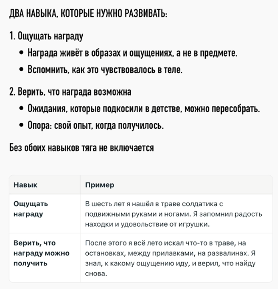
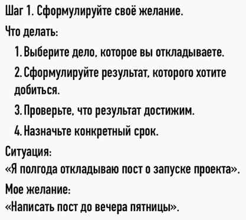
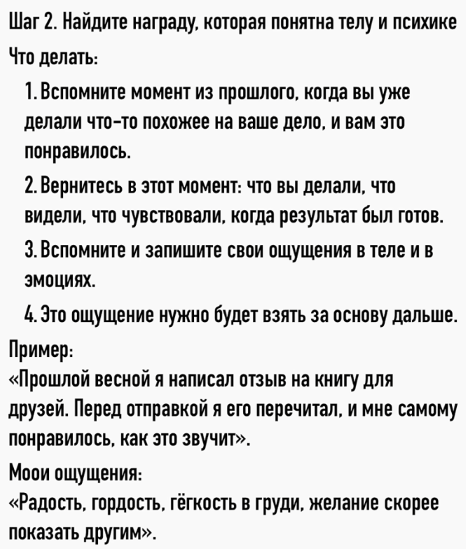
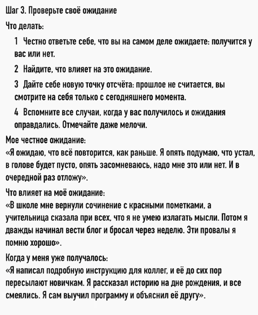
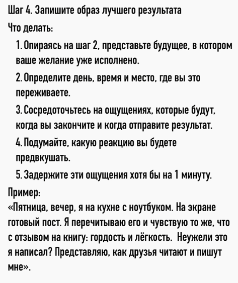
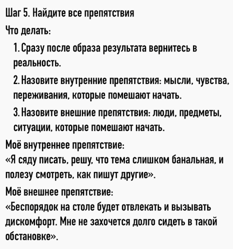
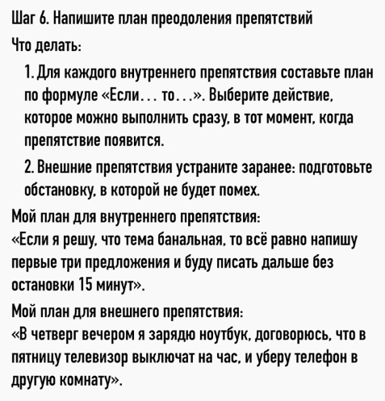
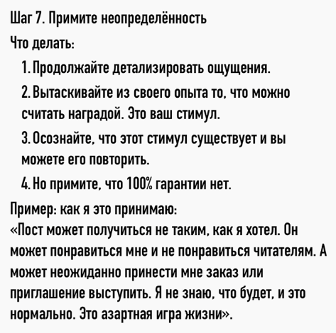

# Как включить тягу к действиям и перестать лениться

https://www.youtube.com/watch?v=tSt0dy03Rpo

## Две разные системы: «нравится» и «хочу действовать»

Вы замечаете, что когда нужно на работу, вы еле просыпаетесь? А вот когда нужно встать пораньше, чтобы улететь в отпуск, тогда вы просыпаетесь раньше будильника, вы бодры, веселы, хотя поспать могли всего лишь пару часов. В конце обычного рабочего дня вы еле-еле ползёте домой, а вот если вечером свидание, то вы забываете об усталости и идёте туда, как будто бы на крыльях, — то есть лень пропадает полностью.

И вам, наверное, кажется, что здесь очень простое объяснение: отпуск и свидания мне нравятся, а вот на работу ходить нет. Но дело как раз в том, что если вам что-то нравится, приятно, комфортно, вкусно, это ещё не означает, что у вас будет тяга это сделать. Оказалось, что в мозге за это отвечают две разные системы.

## Эксперимент 1989 года: дофамин отвечает за тягу, а не за удовольствие

В 1989 году проводили такой эксперимент. Крысам в мозг вводили токсин, который подавлял их дофаминовые нейроны. И вот когда их количество снизилось до 15% от первоначального, крысы перестали есть. То есть еда лежала рядом, они на неё не обращали внимания. И поэтому их пришлось кормить через зонд. Сначала исследователи думали, что они выключили у крыс способность получать удовольствие, и поэтому они перестали стремиться к еде. Но чтобы уточнить эту гипотезу, они провели ещё дополнительный тест — тест реакции на еду. И оказалось, что удовольствие от еды у крыс сохранилось: они продолжали любить поесть, они это показывали мимикой. Пропала только тяга — то есть желание добывать еду и даже просто подходить к ней, если она лежит рядом.

И вот тогда исследователи поняли, что на уровне нейробиологии «нравится» и «хочу действовать» — это две разные системы. И дофамин отвечает не за удовольствие, а именно за притягательность цели. И тогда становится понятно, откуда это удивительное явление, что нас может тянуть даже к тому, что нам не нравится и что нам вредит. И самый яркий пример — это зависимости. Курильщик курит без удовольствия, но его тянет. Человека уже откровенно тошнит от социальных сетей, но он всё равно туда заходит. Лудоман весь в долгах, ему это вредно, но его всё равно тянет поиграть.

## Предвкушение как ключевое состояние

И раз эту тягу можно развить к чему-то вредному, значит можно и к полезному. Надо только понять, как устроено это «хочу». Давайте подумаем, а что с вами происходит в отпуске или перед свиданием? На самом деле вы как будто бы начинаете хотеть всем телом и всей психикой. Вы как будто бы чувствуете вкус этого будущего, и вас туда тянет. Вот это состояние называется **предвкушение**. И именно оно толкает вас к действиям. Секрет людей, которые делают всё без внутреннего сопротивления, как раз в том, что они просто умеют испытывать настоящее предвкушение. Некоторые даже придумывают специальные приёмы. Например, Хемингуэй в одном интервью рассказывал, что когда работает над романом, то всегда заканчивает, пока не устал, — в тот момент, когда ему ясно, что будет дальше. То есть он не дописывал сцену до конца. И именно поэтому он с нетерпением ждал следующего дня, чтобы наконец-то продолжить.

Но у большинства людей так же не получится, потому что вот эта способность предвкушать заблокирована в психике на более глубинном уровне. В этом ролике расскажу, как эта блокировка лишает вас естественного желания действовать. И в конце поделюсь конкретным алгоритмом, как вернуть себе предвкушение, чтобы вы делали всё по собственному желанию, а не по принуждению.

## Что блокирует предвкушение: хронический обман ожиданий

Надо сказать, что люди, которые умеют предвкушать, не всегда обучаются этому осознанно, как Хемингуэй. Дело скорее в том, что человеку просто не помешали развить естественным образом эту способность. А что же мешает? И в первую очередь это хронический обман ожиданий, и начинается это всё с детства. Дело в том, что изначально у вас не было проблем с предвкушением. Вы всегда чего-то хотели. Допустим, на улице вы видели, как кто-то стреляет пульками из пистолета, вам понравилось, вы хотите так же. И вот вы прибегаете домой, рассказываете маме, какой там крутой пистолетик, — «купи, мам, купи». И она вам обещает, а потом, допустим, забывает. Или, хуже, просто говорит: «Нет денег». Если такое повторилось один раз, то ничего страшного. Но если это повторяется постоянно, то уже появляются последствия. То есть у вас просто пропала вера, что желания могут быть исполнены. И вы внутри себя приняли решение: «А зачем мне чего-то хотеть, если я всё равно ничего не получаю? Если хочу, то я часто расстраиваюсь». И у вас просто «хотелка» отмерла.

## Исследование Шульца: дофамин, пессимизм и непредсказуемая награда

На тему обманутых ожиданий было одно интересное исследование. Нейробиолог Шульц решил фиксировать активность дофаминовых нейронов у обезьян. Сначала их научили, что за выбор определённой правильной картинки аппарат выдавал им награду — это порция сока на одну секунду. А потом специально делали так, чтобы за правильный ответ сок не выдавался. То есть обманывали их ожидания. И оказалось, что активность дофаминовых нейронов тут же проседала. То есть становилась даже ниже фоновой. И учёный выдвинул идею, что это как обучающий сигнал: раз получилось хуже, чем ожидалось, значит надо обновлять картину мира, снижать ожидания. И можно сказать, что на уровне нейробиологии вот именно так формируется **пессимизм**.

Но ещё интереснее то, что постоянное оправдание ожиданий тоже снижает предвкушение. То есть учёный увидел, что если обезьяна стабильно всегда получала награду за правильный ответ, то у неё со временем нейроны также переставали реагировать. И мы то же самое видим у людей. Если в детстве всё подносят на блюде, всё легко достаётся по первой просьбе, то у ребёнка хуже развивается стремление. Ну, надо сказать, что всплеск активности нейронов ещё происходил, если награды давали больше обычного. И Шульц даже сравнивал дофамин с маленькими бесами, потому что они всё время подталкивают к новым наградам, потому что старые перестают возбуждать.

И тут у вас возникает вопрос: а означает ли это, что для развития предвкушения нам всё время надо больше, больше и больше? И ответ — нет, не означает. А дело в том, что в более поздних исследованиях Шульц обнаружил, что дофаминовые нейроны сильнее всего реагируют именно на **непредсказуемую награду**. Эксперименты были похожи, но теперь учёные задавали разную вероятность получения награды. И самая сильная реакция была при максимальной неопределённости, то есть при шансах 50 на 50. Какой можно сделать вывод для обычной жизни? Дело в том, что нормальная способность к предвкушению формируется у ребёнка, если у него были и обломы с ожиданиями, и какие-то победы, вымученные, и неожиданные радости без усилий. То есть обычная непредсказуемая жизнь — вот эти все спады и подъёмы — это необходимое условие, чтобы наше предвкушение работало. Но в то же время не должно быть долгое время травматических обломов, отказов, разочарований. И к сожалению, у нас несколько поколений выросло в нищете. И поэтому людей именно с таким опытом у нас очень много.

## Два навыка: ощущать награду и верить, что её можно получить

Если у вас тоже не было нормального опыта получения каких-то значимых наград, то вам в первую очередь нужно развивать два навыка. Первый — надо уметь **ощущать награду**. Чтобы возникло предвкушение, нужно то, к чему вас будет тянуть. Но тут речь не о материальных объектах, а именно об опыте, который у вас сохранён в виде образов, ощущений и чувств. Для примера расскажу историю своего детства. Когда мне было лет шесть, я гулял на территории детского садика, ну и заглядывал там во все щели. И я случайно, за верандой, нашёл универсального солдатика. То есть это игрушка, у которой двигаются голова, руки, ноги, — то есть это прям супер-находка. Я получил удовольствие и от самой игрушки, и от факта находки. У меня эти ощущения сохранились, и они стали для меня ориентиром. Второй навык заключается в том, что **нужно верить, что эту награду получить возможно**. То есть нужна работа с вашими ожиданиями, которые подкосили в детстве. Из-за того, что я случайно нашёл игрушку, у меня появилась вера, что такое возможно. И я потом всё лето пытался тоже что-то найти: там другие игрушки, деньги на остановках, лазил по помойкам, по каким-то развалинам. То есть у меня появилась тяга к этому. Упражнение для развития этих навыков будет дальше в алгоритме.

## Что не является предвкушением: опасность идеализированных фантазий

А сначала нужно ещё поговорить, а что не является предвкушением. Многие, наверное, уже подумали, что сейчас речь пойдёт о том, что надо визуализировать, представлять результат, как всё будет классно, и тогда всё получится. Вот нет, это вообще речь не об этом. Если так делать, наоборот, можно навредить своему предвкушению и снизить тягу к действиям. На эту тему тоже было отдельное исследование. Профессор психологии Габриэль Эттинген решила проверить, а как отдельно ожидание и отдельно фантазии связаны с результатами деятельности. Один из экспериментов был со студентами, которым предстояло сдать экзамен. И у них спрашивали, какую оценку они хотят получить, а потом просили оценить вероятность её получения — так замеряли ожидания. Потом их просили описать сценарий, а что будет после сдачи, и оценить, насколько вот эти образы приятны для них. Это был замер фантазии. И каждому замеру присвоили какое-то количество баллов в зависимости от ответов. Допустим, ожидание семь, фантазия три. То есть у кого-то был перекос в сторону фантазии. И потом просто смотрели, как студент реально занимался и какую оценку получил. И сравнивали с вот этими баллами. В итоге получилось, что у кого балл ожидания был выше, они в итоге лучше занимались и получали более высокие оценки. А у кого перекос был в сторону фантазии, они меньше занимались и получали низкие оценки. А второе объясняется тем, что эта приятная картинка фантазии позволяет сразу прожить желаемое будущее, и поэтому психика просто не мобилизуется. Но вредят не любые мечты, а только идеализированные. Это когда человек представляет только результат, но не думает о плане действий и о том, что нужно преодолевать какие-то препятствия.

## Алгоритм из семи шагов для создания предвкушения

И сейчас я расскажу весь алгоритм, как правильно мечтать, как создавать у себя предвкушение, которое будет вас побуждать к действию. После алгоритма сразу не уходите: я ещё расскажу об одной бессознательной причине, которая гасит вообще любое предвкушение, и расскажу, как её устранять.

Вы берёте одно конкретное дело, которое давно откладываете. Допустим, я хочу поделиться своим опытом, написать большой пост на профессиональную тему.

**Шаг 1. Сформулировать достижимый результат с конкретными сроками.** Допустим, хочу написать пост до пятницы.

**Шаг 2. Найти награду, понятную телу и психике.** Нужно вспомнить похожий опыт, когда я уже писал что-то, и мне понравилось. Или у меня уже была хорошая статья, или я написал какое-то подробное письмо другу. Вот я перед правкой его читаю, и мне самому приятно. Тут надо вспомнить и записать именно свои ощущения. Допустим, я испытывал радость, гордость, лёгкость, такое небольшое возбуждение и тягу скорее отправить. Вот это ощущение я буду потом брать за основу.

**Шаг 3. Проверить своё ожидание.** Здесь нужно именно честно ответить, а что вы на самом деле ждёте? Допустим, я могу сказать, что вот да, я сейчас сделаю упражнение после ролика. Вроде бы есть какая-то маленькая надежда, что получится, но она вот прям крохотная. А ожидаю на самом деле, что всё повторится вот как раньше: я опять подумаю, что устал, в голове будет пусто, опять засомневаюсь, а надо мне это или нет, и в очередной раз всё отложу. Подумайте и распишите, а что влияет на ваши ожидания. И скорее всего окажется, что это прошлый опыт. То есть другие люди когда-то обманывали ваши ожидания, вы обманывали собственные, и вы больше фокусируетесь именно на негативном опыте, и он влияет на ваши прогнозы. Когда всё это осознаете, разрешите себе создать новую точку отсчёта для формирования новых ожиданий. Прошлое как будто бы не считается, и вы смотрите на себя только из сегодняшнего момента. А чтобы себя поддержать в этой начальной точке, вспомните все случаи, когда у вас получалось, когда ваши ожидания оправдывались, и отмечайте даже то, что считаете мелочью. Вы удивитесь, насколько много таких событий.

**Шаг 4. Записать образ идеального результата.** То есть я здесь опираюсь на второй шаг, представляю уже в будущем это. То есть, допустим, пятница, вечер, я сижу за столом, на экране у меня готовый пост, я его перечитываю, и у меня внутри снова вот это чувство радости, удовольствия, предвкушения. Я думаю: «Неужели это я написал?» Подумайте и попробуйте прочувствовать вот эту реакцию, которую вы будете предвкушать, и попытайтесь задержать её хотя бы на одну минуту.

**Шаг 5. Определить внешние и внутренние препятствия.** Моё внутреннее препятствие будет в том, что я открою пустой документ, не пойму, с чего начать, и у меня возникнет мысль, что вот пока вдохновение не пришло, пойду попью чай, и в итоге не вернусь. А внешнее препятствие в том, что я сяду за рабочий стол, а там будет много книг, какие-то бумаги, станет дискомфортно от этого беспорядка, я захочу прерваться и тоже снова пойду там листать ленту или пить чай.

**Шаг 6. Заранее написать план преодоления этих препятствий.** Если это внутреннее препятствие, то я могу использовать такую формулу: «Если…, то…». То есть я себе заранее записываю, что если я открою документ и не пойму, с чего начать, то я напишу любую первую фразу, например: «Недавно я понял, что…», и дальше буду писать всё, что приходит в голову. А внешнее препятствие устраняется просто заранее. То есть если я вспомнил, что меня отвлекают вещи на столе, то я заранее готовлю себе приятную обстановку, всё убираю, прячу, и мне становится более комфортно работать.

**Шаг 7. Принятие неопределённости.** То есть я создаю, что награда существует, и я верю, что я могу её получить, но при этом нет гарантии 100%, что это случится именно сейчас. Может, у меня статья получится, а может быть, и нет. То есть это азартная игра жизни. Может быть такое, что я просто получу то, что ожидал, а может быть, будет неожиданный эффект. То есть публикация как-то «разорвёт», принесёт мне признание и дополнительный доход. Повторяйте эти семь шагов, и у вас постепенно сформируется нормальное естественное предвкушение, которое будет создавать тягу для действий.

## Аверсивность задачи: как снизить неприятность дела

Теперь поговорим о том, что может сильно снижать ваше предвкушение. Профессор психологии Пирс Стил проанализировал вообще все исследования по прокрастинации и определил, что есть один из самых главных демотиваторов. Он называл это «аверсивность задачи». Если по-простому, то это когда задача неприятна сама по себе. То есть из-за того, что приходится терпеть дискомфорт, то все вот эти положительные эмоции от награды перекрываются. Например, при написании статьи мне может быть очень неприятно, что у меня сразу не получается сформулировать мысль, или я не люблю тупики, когда вот я не знаю, что написать, надо лезть куда-то в источники. И вот это мне придётся терпеть по несколько часов, несколько дней подряд. И кажется, что раз это неприятно, то уже ничего не поделаешь. Но даже с этим можно справиться.

Неприятность почти любой задачи можно снизить, если найти корень этих переживаний. Допустим, я провёл некоторый анализ и понял, что у меня все неприятные ощущения возникают только потому, что у меня завышенные ожидания от самого себя. То есть я требую от себя писать сразу же из головы, не разрешаю себе использовать источники; если у меня не получается, то я чувствую себя тупым. А ещё я обнаруживаю такую идею, что мне почему-то кажется, что все люди умные, они просто берут и за 30 минут сразу выдают готовый крутой материал. Им даже не надо ничего править, а я вот такой глупый, мне приходится вымучивать из себя по несколько дней. То есть эта задача неприятна только потому, что я чувствую себя глупее других авторов, я чувствую себя глупым. И вот это можно легко исправить, если привести мои ожидания ближе к реальности. То есть я могу целенаправленно подумать: вот откуда у меня вообще идея про других авторов? Я могу это проверить, почитать, как у кого всё устроено, и приду к выводу, что у всех по-разному. И вообще, оказывается, многие авторы очень долго работают над хорошими текстами. И когда я внутренне это принимаю, когда я снижаю ожидания и требования, я сразу успокаиваюсь, и мне проще приступить к этой задаче, у меня уже начинает работать предвкушение. И вы тоже можете научиться находить причину, почему задача неприятна, снижать эти ощущения, и тогда вам будет проще приступать.

# Резюме

- В мозге за «нравится» и «хочу действовать» отвечают две разные системы; дофамин связан именно с тягой (притягательностью цели), а не с удовольствием.
- Эксперимент 1989 года с крысами показал: несмотря на сохранение удовольствия от действия (еда), тяга к нему может пропадать (добыча еды). Тягу можно развить и к вредному (зависимости), и к полезному.
- Ключевое состояние, создающее тягу, — **предвкушение**. Оно толкает к действию (пример Хемингуэя: заканчивать работу, пока не устал, на моменте ясности, что будет дальше).
- Предвкушение блокируется хроническим обманом ожиданий с детства: если желания постоянно не исполняются, «хотелка» отмирает.
- Исследование Шульца: как обманутые ожидания, так и постоянное лёгкое оправдание ожиданий снижает предвкушение. Сильнее всего нейроны реагируют на **непредсказуемую награду** (шанс 50/50) — нужна обычная непредсказуемая жизнь со спадами и подъёмами, но без длительных травматических обломов.
- Для развития предвкушения нужны два навыка: уметь ощущать награду (сохранённый опыт образов, ощущений, чувств) и верить, что награду можно получить (работа с ожиданиями).
- Идеализированные фантазии (только результат без плана и препятствий) вредят: исследование Эттинген показало, что высокие ожидания улучшают результат, а перекос в фантазии — ухудшает.
- Алгоритм из семи шагов: 1) достижимый результат со сроком; 2) найти понятную телу награду из похожего опыта; 3) честно проверить ожидания и создать новую точку отсчёта; 4) записать образ идеального результата и прочувствовать его; 5) определить внешние и внутренние препятствия; 6) заранее написать план их преодоления (формула «Если…, то…»); 7) принять неопределённость.
- Главный демотиватор — **аверсивность задачи** (неприятность сама по себе, по Пирсу Стилу). Её можно снизить, найдя корень переживаний (часто это завышенные ожидания от себя) и приведя ожидания ближе к реальности.