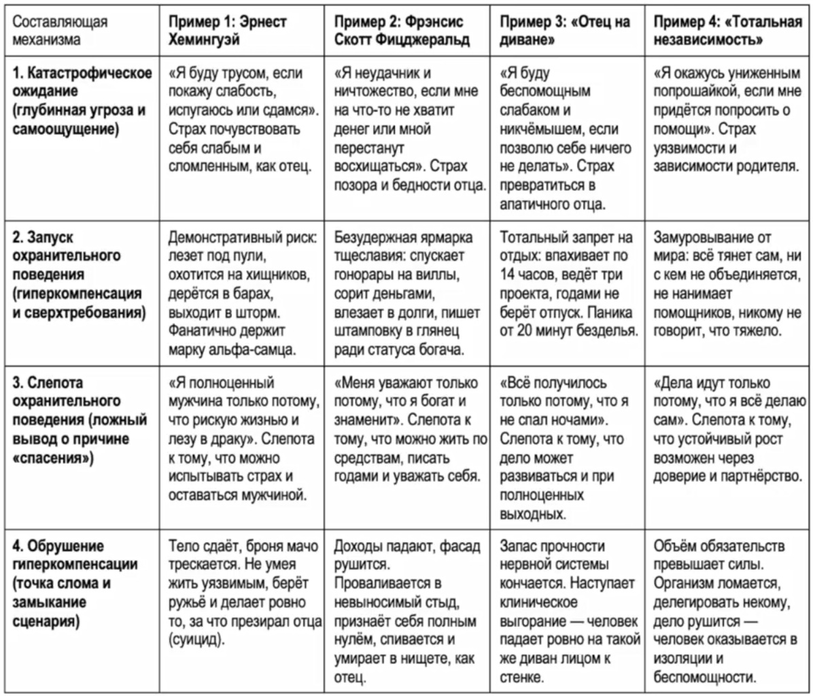
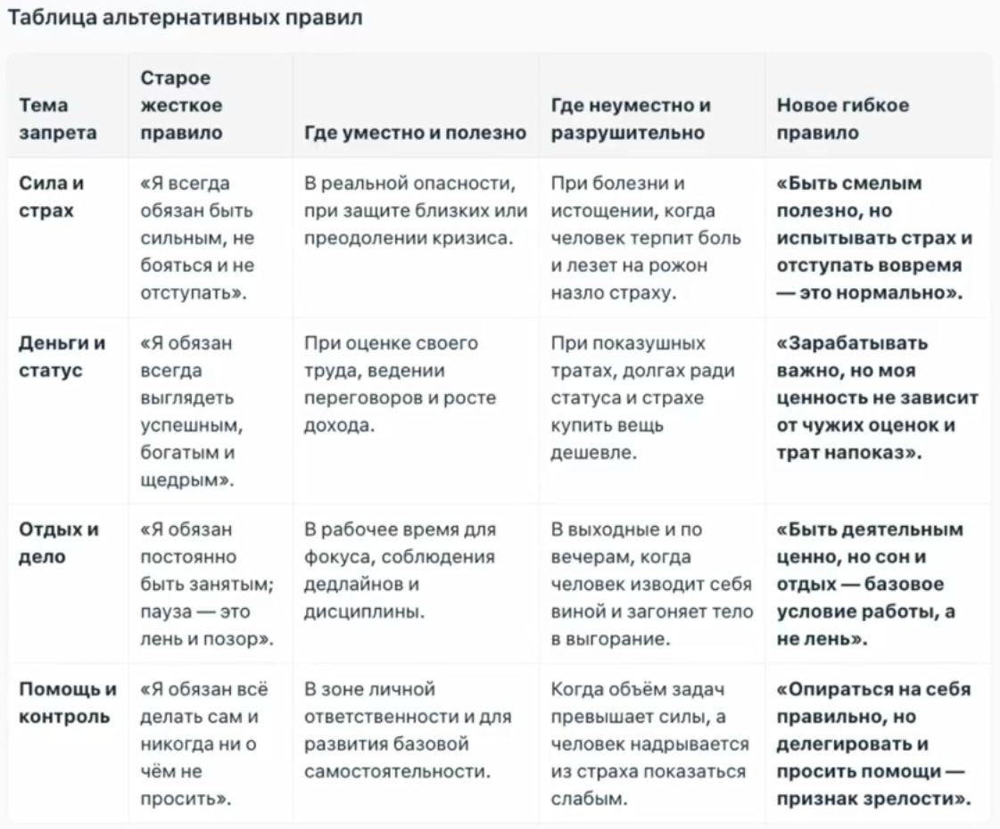
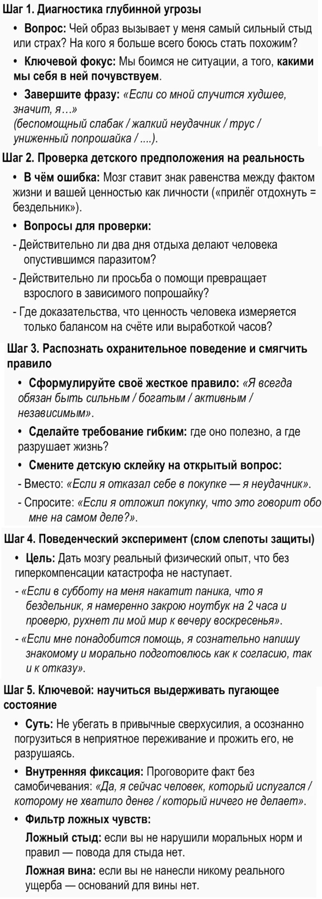
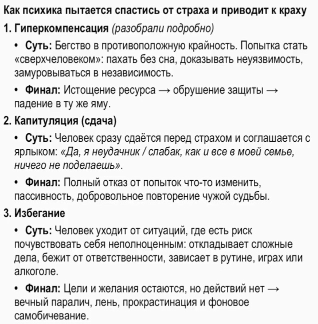

# Это заставит тебя повторить судьбу отца. Алгоритм взлома негативных сценариев

https://www.youtube.com/watch?v=mH9eCLnL-ys

## Почему мы повторяем чужую судьбу и как это остановить

Кларенс Хемингуэй ушёл из жизни в 57 лет. Он застрелился. Его сын, Эрнест Хемингуэй, позже у себя в заметках писал: «Мой отец был трусом. Он застрелился без всякой необходимости». Окружение вспоминало, что Эрнест неоднократно повторял, что он никогда так не поступил бы. И действительно, он всю жизнь презирал слабость и очень жёстко относился к людям, которые опускают руки. Но в 61 год он взял охотничье ружьё и сделал ровно то же самое, что и его отец.

Бывало ли у вас такое, что вы смотрите на своего родителя, родственника или знакомого и думаете: «Я сделаю всё, но у меня так не будет. Я таким не стану, так я жить не хочу»? Дело в том, что многие так думали. Никто не планировал стать озлобленным 40-летним мужиком, который самоутверждается на кассирах. Никто не хотел терять смысл жизни, никто не планировал спиваться или становиться нищим. Но почему-то это всё равно случается.

А всё потому, что внутри работает скрытый психологический механизм, который и отвечает за повторение чужой судьбы. Он сработал даже у Хемингуэя, а у него было поведение абсолютного альфа-самца. И этот механизм мощнее вашей силы воли. Если его вовремя не вскрыть, не остановить, то с вами случится именно то, от чего вы хотите убежать.

В этом ролике расскажу, как устроен этот механизм, почему мы его не замечаем, и дам пошаговый алгоритм, как его у себя найти и вовремя остановить.

## Три типичных примера

Давайте посмотрим на типичных примерах, которые встречаются постоянно.

**Первый пример — это как было у писателя Скотта Фицджеральда.** Его отец сначала прогорел с фабрикой мебели, потом он устроился коммивояжёром в Procter & Gamble, а оттуда его с позором уволили за профнепригодность. Он не мог содержать семью и жил за счёт родственников жены. В личных записях Фицджеральд признавался: «В тот день я понял, что мой отец — неудачник. Я поклялся себе, что я никогда в жизни не окажусь на его месте». Он решил стать его противоположностью — добиться признания, славы и денег. Но закончилось всё тем, что в 44 года он умер в съёмной квартире, забытый, с огромными долгами и с полным убеждением, что он такой же неудачник, как и его отец.

**Второй пример — это знакомая история очень многим людям.** Ребёнок растёт и каждый день видит отца, который после работы приходит, ложится на продавленный диван, ничем не интересуется, смотрит телевизор, ругает власть и начальника, жалуется на тяжёлую жизнь — и он ничего не делает, чтобы это изменить. Ребёнок на это смотрит и думает: «Я таким никогда не буду, я не хочу так жить». А потом проходит 20 лет, и уже он заходит домой, просто падает на диван, не может пошевелиться или живёт в полной апатии.

**Третий пример** — это когда человек с детства видел, как кто-то из его родителей терпел унижение и не мог уйти, потому что либо зависел материально, либо психологически. И тогда он думает: «А вот я ни от кого не буду зависеть, ни у кого не попрошу о помощи». Но проходит 15 лет, он ломается под грузом проблем, он в полной изоляции и он снова вынужден к кому-то обращаться за помощью.

И возникает вопрос: а почему так случается с людьми? На первый взгляд может показаться, что просто не повезло, так сложились обстоятельства. Но когда вы узнаете, что и как делали эти люди, вы увидите, что они буквально сами вели себя к этой пропасти.

## Что такое парадокс охранительного поведения

В когнитивной психологии это явление называют **парадокс охранительного поведения**. Он как раз объясняет, как именно человек своими же собственными действиями создаёт именно ту ситуацию, от которой он пытался убежать.

У этого парадокса есть четыре составляющие.

### 1. Катастрофическое ожидание

Оно формируется на основе травматического опыта. Если со мной или с моими близкими произошло что-то болезненное, то я буду бояться этого и буду пытаться это предотвратить. Это ожидание формулируется в виде катастрофических предположений.

Допустим:
- у Хемингуэя: «Я буду трусом, если покажу слабость, испугаюсь или сдамся»;
- у Фицджеральда: «Я неудачник, если мне на что-то не хватит денег или мной перестанут восхищаться»;
- в примере с диваном: «Я буду слабаком, если позволю себе расслабиться и ничего не делать».

### 2. Запуск охранительного поведения в виде гиперкомпенсации

То есть, чтобы избежать этой катастрофы, человек автоматически вырабатывает какие-то правила, принципы, требования: каким надо быть, как надо себя вести, как выглядеть — чтобы не почувствовать себя неудачником, слабаком, трусом или нуждающимся. И он начинает навязчиво следовать этой стратегии.

- **Хемингуэй**, чтобы не показаться трусом, постоянно демонстративно лез в опасные ситуации: охотился где-нибудь на хищников в Африке, участвовал в войне добровольцем, плавал в шторм, дрался в барах. То есть он фанатично придерживался маски альфа-самца.
- **Фицджеральд**, чтобы не выглядеть нищим, устраивал ярмарку тщеславия: спускал гонорары на виллы, на отели, заказывал приёмы на сотни гостей, а когда деньги заканчивались — влезал в долги, только чтобы не выпасть из образа миллионера.
- Человек, который боится оказаться на диване, работает по 14 часов в день, ведёт сразу несколько проектов, отказывается от отпуска и считает, что преступление это если он хотя бы 20 минут ничего не делал.
- Человек, который боится зависимости, он тянет всё в одиночку, ни с кем не объединяется, не делегирует задачи и всё тянет на себе.

### 3. Слепота охранительного поведения

То есть, когда человек навязчиво придерживается своей стратегии и не сталкивается со своими страхами, он приписывает своё спасение исключительно этой стратегии. А из-за этого человек в принципе не может опровергнуть свои убеждения, что без всех этих мер возможна какая-то нормальная жизнь.

- **Хемингуэй** каждый раз для себя подтверждал: «Я чувствую себя полноценным, потому что я смелый, потому что я пошёл добровольцем на войну, потому что начал драку, потому что пошёл в море в шторм». И реальность, где можно испытывать страх и оставаться мужчиной, — для него это закрыто.
- **Фицджеральд** постоянно утверждался в идее, что его уважают только потому, что он богат и знаменит. Он не мог увидеть, что писатель вообще-то может жить по средствам, писать глубокие книги годами и при этом принимать себя.
- Человек, который запрещает себе отдых, постоянно утверждается: «Всё получилось только потому, что я не спал ночами, работал по выходным». Он не видит, что дело может и идти в гору, и при этом можно в субботу-воскресенье вообще не думать о делах.
- В примере со страхом попасть в зависимость человек думает, что дела идут хорошо только потому, что «я всё делаю сам». А возможность и расти, и при этом быть в партнёрстве — для него это тоже не существует.

### 4. Обрушение

Потому что любая гиперкомпенсация требует огромных физических и психических ресурсов, организм не способен долгое время поддерживать такой режим нагрузки, и поэтому всегда наступает точка слома.

- **Хемингуэй** не смог всю жизнь глушить свой естественный страх. К шестидесяти годам тело ослабло, началась тяжёлая депрессия, паранойя. Когда броня альфа-самца треснула, он просто не знал, как жить без этой маски. И поэтому он взял ружьё и сделал то, за что презирал своего отца.
- У **Фицджеральда** не получилось бесконечно поддерживать образ богача. Когда гонорары упали, он не смог принять реальность, провалился в стыд, признал себя полным нулём, спился и умер в съёмной квартире в полном одиночестве.
- Также ни у кого не получится 15 лет работать на износ. Запас прочности обязательно закончится, придёт выгорание, депрессия, человек просто ляжет на диван и не сможет даже встать, чтобы почистить зубы.
- Не получится одновременно и растить бизнес, и всё делать самому. Человек обязательно выдыхается, дело рушится, и он остаётся у разбитого корыта. И жизнь его заставляет почувствовать вот эту зависимость.

И возникает главный вопрос: а как вычислить вот этот механизм, остановить сценарий, чтобы он не дошёл до точки слома?

## Пошаговый алгоритм: как найти и остановить механизм

Давайте переходить к алгоритму. Нужно будет пройти по всем четырём составляющим и в каждой найти ошибку. Последний шаг — он ключевой, без него схема не заработает, поэтому уделите ему особое внимание.

### Шаг 1. В чём ошибка первой составляющей?

Человек часто думает, что он боится именно внешних обстоятельств: что подумают, что он трус, или он потеряет работу, или останется без денег. Но это иллюзия. На самом деле человек боится не ситуации, а того, как он сам себя в ней будет чувствовать. Мы всегда боимся именно болезненных ощущений.

Для начала задайте себе два вопроса:

1. А чей образ вызывает у меня самый сильный стыд, раздражение или страх? На кого я больше всего боюсь стать похожим?
2. А если в моей жизни случится наихудшее и я окажусь именно на месте этого человека — каким я себя почувствую?

И завершите фразу: «Если это произойдёт, значит я…». Ну, допустим: «…беспомощный слабак, как отец на диване, ненужный или жалкий неудачник, ничтожество, как отец Фицджеральда», или «…я трус, который сдался, как отец Хемингуэя», или «…я униженный попрошайка, если мне придётся просить о помощи».

Вот это чувство — это и есть корень проблемы. Именно от него вы бежите всю жизнь.

### Шаг 2. В чём ошибка второй составляющей?

Она в том, что человек ставит знак равенства между фактом из своей жизни и собственной ценностью. «Если я прилёг отдохнуть — я ленивый паразит». «Если мне не хватает денег на дорогую вещь — значит, я неудачник».

Вам нужно вспомнить, а когда именно появился такой вывод? И скорее всего, это было в детстве. Вам нужно понять, что этот вывод наивный. Это ошибка — считать, что по одному факту из моей жизни можно сделать глобальные выводы о моей личности.

После этого, уже со взрослой точки зрения, ответьте на прямые вопросы:
- А действительно ли человек, который взял два выходных, автоматически становится бездельником?
- А правда ли, что если вы попросили о помощи, передали кому-то задачу, то вы стали слабым и зависимым ничтожеством?
- А где доказательство, что ваша ценность измеряется только суммой на банковском счёте?

### Шаг 3. В чём ошибка третьей составляющей?

В том, что человек думает, что его гиперкомпенсация — то есть свод его жестких требований, правила, каким надо быть, как себя вести, как выглядеть, — что это единственный способ спастись от катастрофы.

Чтобы это исправить, чтобы видеть другие пути, нужно развивать гибкость психики. Это делается при помощи постоянного поиска альтернатив.

Для начала понаблюдайте за своим поведением и сформулируйте, какому оно подчиняется правилу. Допустим, если смотреть на поведение Хемингуэя, то он всегда следовал правилу: «Я должен быть сильным». Фицджеральд следовал правилу: «Я должен быть богатым и щедрым».

Потом сформулируйте более мягкое и гибкое требование. Самое простое — это через детализацию: в каких ситуациях это правило правда полезно, а в каких оно вредно и мешает. Затем сформулируйте более реалистичные гибкие предположения. «Если я сдержался и не полез в драку — а что это говорит обо мне на самом деле?» Ну, например, что я сдержанный человек, я контролирую свои эмоции, и в этом тоже моя сила. И продолжайте развивать вот эту мысль, ищите нейтральные и позитивные значения. Очень часто оказывается, что какой-то факт вообще не имеет никакого значения. Ну, допустим, если я отказал себе в дорогой покупке — что это говорит обо мне? Да вообще ничего, это никак не характеризует мою личность, ни с плохой, ни с хорошей стороны.

### Шаг 4. Сломать слепоту охранительного поведения

Чтобы ваш мозг убедился, что мир не рухнет без ваших привычных защит, ему нужен новый реальный опыт. Лучше всего помогают маленькие поведенческие эксперименты.

Допустим, если в субботу я почувствую тревогу, что я бездельник и превращаюсь в отца, то я не буду открывать ноутбук — я оставлю его закрытым и пойду гулять на два часа. Потом меня отпустит, я буду снова заниматься своими делами. Когда вы сознательно нарушаете старые принципы и правила и видите, что ничего катастрофического не происходит — вот только тогда мозг начинает перестраивать свои цепочки, и ваша картина мира меняется.

### Шаг 5. Ключевой шаг

И последний, пятый шаг — он ключевой. Но после него сразу не уходите: я расскажу ещё о двух бессознательных стратегиях, которые тоже ведут к грустным сценариям жизни.

Итак, чтобы ваша жизнь пошла по благополучному сценарию, самое главное, чему нужно научиться, — это выдерживать состояние, которое вы больше всего боитесь. Потому что именно непереносимость этого чувства заставляет вас изобретать какие-то стратегии. Но это чувство оно совершенно обычное для всех людей. То есть можно выдержать и стыд, и вину, и беспомощность, и свою трусость. Дело в том, что у вас это связано с какой-то травматической ситуацией.

- Если бы Хемингуэй умел выдерживать моменты своей слабости и трусости, тогда бы он продолжал жить.
- Если бы Фицджеральд научился выдерживать себя, когда он в чём-то себе отказывает или когда он на публике демонстрирует экономность, то он тоже бы спокойно жил.

И нужно просто погружаться в это тяжёлое состояние и находиться в нём какое-то время. То есть можно даже проговаривать про себя: «Да, я человек, который испытывает слабость. Да, я человек, который испугался. Да, я человек, которому не хватает денег». Именно когда мы переживаем свою слабость, беспомощность — наш организм восстанавливает силы. То есть это тоже часть нашей естественной жизни.

Обращайте внимание, есть ли в ваших чувствах примесь вины и стыда, и проанализируйте, а есть ли вообще основание для этих чувств. Допустим, если вы ничего не сделали такого, что нарушает общественные нормы и правила, то у вас нет повода для стыда — то есть это ложный стыд. Если вы не причинили вред либо ущерб, то у вас нет основания для чувства вины — то есть это ложная вина.

Выдерживать эти состояния — это значит их проживать, при этом не разрушаясь. Возвращайтесь регулярно к этим пяти шагам, и тогда вы точно не повторите чужую судьбу.

## Две другие бессознательные стратегии

Я рассказал о стратегии гиперкомпенсации, но это только одна из трёх стратегий, которая возникает автоматически и ведёт к жизненному краху. Есть ещё две.

1. **Капитуляция** — когда человек сразу сдаётся, говорит: «Я неудачник, и ничего с этим не могу поделать». И он просто перестаёт что-то предпринимать.
2. **Избегание** — это когда человек откладывает всё на последний момент, не берётся за сложные дела, убегает от ответственности, хотя на самом деле она ему посильна.

В этих двух стратегиях человек тоже спасается от каких-то неприятных ощущений, но просто через уход от действия. Но желание и цели у него при этом остаются, поэтому он мучается от лени и прокрастинации, но никак не может себя пересилить.

О том, как уйти от стратегии избегания, у меня есть отдельная лекция. Она называется «Формула продуктивности». Там я рассказываю, при каких пяти психологических условиях у человека возникает естественное желание действовать.